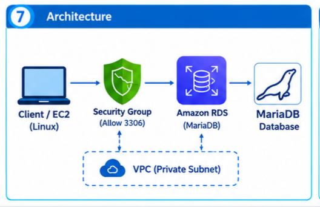

# amazon-rds-mariadb-aws-WS
Deployed a MariaDB relational database using Amazon RDS, configured secure connectivity from Amazon EC2, and performed SQL CRUD operations within an AWS VPC.

Amazon RDS on AWS – MariaDB Database Deployment

Project Overview

This project demonstrates how to deploy and connect to a MariaDB database using Amazon RDS on AWS. It covers database creation, SQL operations, and secure connectivity from an application server.

AWS Services & Technologies

- Amazon RDS: Managed relational database service
- MariaDB: Database engine
- Amazon EC2: Client server for database connectivity
- Amazon VPC: Network configuration
- Security Groups: Network access control
- SQL: Database management and CRUD operations

## Project Architecture

Features

- Create a MariaDB database and employee table
- Insert, retrieve, update, and delete records
- Connect to RDS using a MariaDB client
- Configure secure database connectivity

Project Structure

amazon-rds-mariadb-aws-/
├── README.md
├── Architecture.png
├── sql/
│   └── employee_db.sql
└── docs/
    └── architecture.md

How to Use

1. Create an Amazon RDS MariaDB instance.
2. Configure the VPC and security groups to allow access only from authorized sources.
3. Connect using a MariaDB client.
4. Execute the SQL script in "sql/employee_db.sql".

Practical experience with AWS RDS, MariaDB, SQL CRUD operations, cloud networking, and database security.

Author

Pratiksha Pawar 

